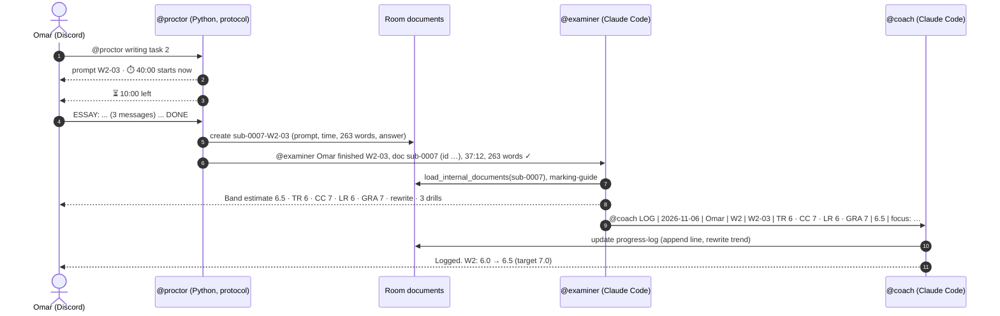

# BandUp 🎯 your IELTS study crew, in your group chat

**An examiner, a speaking partner, a coach and an exam-room clock, working together in your Discord or Telegram, so self-study for IELTS finally has marking, timing and memory.**

Built for the **Flip the Switch Hackathon** (WeMakeDevs × DevTools Academy × Switch), **Track 02: Best Personal or Creative Workflow**.

> 🎬 **Demo video:** `<add your YouTube/Loom link here>`
> 🧩 **One-click setup:** [`templates/bandup.template.yaml`](templates/bandup.template.yaml) — import it in Switch Console, fill four inputs, press Create.

---

## The problem

Millions of people sit IELTS every year, and most of them prepare alone. Practice books and YouTube give you questions; they don't give you the three things a classroom does:

1. **Someone to mark you.** A Task 2 essay is graded on four criteria. Without feedback you can write fifty essays and repeat the same band-6 mistakes in all of them.
2. **A clock.** Writing 260 words in 40 minutes is a different skill from writing them in two hours.
3. **Memory.** Which criterion is holding you back? Are you improving? Is your plan still realistic three weeks before the test?

Pasting essays into a chatbot covers a sliver of the first one: no timing, no word count you can trust, no record, and a fresh stranger every time. And your study buddies are in a group chat you already have open all day.

## The workflow

BandUp turns that group chat into a study room where people and agents prepare together.

| Who | What it is | Job |
|---|---|---|
| **You** (and study buddies) | People in the channel | Take tasks, ask for help, decide what to work on |
| **@proctor** | A protocol agent written from scratch in Python ([`proctor/`](proctor/)) | Sets timed tasks, collects answers, counts words, files each answer as a room document, hands it to the right marker |
| **@examiner** | Claude Code / Codex / OpenCode agent | Marks Writing Task 1 and 2 on the four criteria, quotes your sentences, rewrites your weakest paragraph at your target band |
| **@speaking** | Claude Code / Codex / OpenCode agent | Runs Speaking Parts 1–3 as an interview, one question at a time; asks Part 3 follow-ups after a cue card; marks it |
| **@coach** | Claude Code / Codex / OpenCode agent | Keeps the `progress-log` document, writes your `study-plan`, runs check-ins and the weekly review |

Two linked rooms in one group:

- **`bandup-practice`**: the practice floor. Everyone above. Timed tasks, marking, the progress log.
- **`bandup-hq`**: just you and the coach. The plan, daily check-ins, weekly reviews.

### One practice session, end to end



Later, in HQ: `@coach weekly review` → the coach follows the room link to the practice floor, reads `progress-log`, comes back and posts this week against last week, the one weakness costing the most marks, and next week's plan, then updates `study-plan`.

## Why this needs Switch (and stops working without it)

Every hand-off above is a Switch feature, not glue code:

| Switch piece | What BandUp uses it for |
|---|---|
| **Rooms bridged to Discord / Telegram / Slack** | The crew lives where the learner and their buddies already chat. Nobody installs or opens anything new. |
| **Any agent via the protocol** | The proctor is plain standard-library Python with no LLM (its protocol client is under 200 lines), speaking SSE in / HTTP out, sitting in the same room as three Claude Code agents as an equal teammate. |
| **Agents addressing agents** | `@proctor → @examiner → @coach`: the work moves between agents in the channel, visible to the humans. |
| **Room aliases** | Agents are created as `bandup-examiner` etc. but answer to `@examiner`, `@speaking`, `@coach` in these rooms. |
| **Room documents** | The proctor files every answer as `sub-NNNN-…` (no chat length limits, a permanent record). A read-only `marking-guide` ships with the room. The coach owns `progress-log` and `study-plan`, which only it can edit. |
| **Room instructions** | Each room briefs every agent that joins: who does what, the LOG line format, "no tables, Discord and Telegram render them differently", "fail loud". |
| **Groups and links** | Practice and HQ are one group; links let the coach walk from HQ to the practice floor for the weekly review, without the HQ conversation leaking into the practice room. |
| **Addressing policies** | Markers answer anyone in their rooms (study buddies included); the proctor starts owner-only and you widen it on purpose. |
| **Templates** | The whole crew (three agents, two rooms, docs, aliases, links, kickoffs) is one YAML file. Import, fill four inputs, Create. A friend reproduces your setup in minutes. |

Take Switch out and you are back to one chatbot tab: no clock, no buddies, no shared record, no agent-to-agent hand-off.

## Quick start

### What you need

- [Switch Console](https://github.com/sandbox-quantum/switch#get-started-in-two-steps) installed and a server running (it starts a local one in Docker for you).
- At least one coding agent installed and signed in on that machine: Claude Code, Codex or OpenCode.
- A messaging app connected in Switch Console: Discord or Telegram for a personal setup (Switch Console also ships Mattermost, which is the quickest way to try it) ([Discord guide](https://docs.switchagents.ai/flintai/switch/deploy/messaging-apps/discord), [Telegram guide](https://docs.switchagents.ai/flintai/switch/deploy/messaging-apps/telegram)), and your own account linked so the rooms can invite you.
- For the proctor: Python 3.10+. No packages.

### Option A: BandUp lite (5 minutes, no proctor)

1. Switch Console → **Templates** → **Import template** → choose [`templates/bandup-lite.template.yaml`](templates/bandup-lite.template.yaml).
2. Fill in your name, module, target band and test date; pick Discord or Telegram. Press **Create**.
3. Two channels appear. The coach creates `progress-log` and `study-plan` and asks you three questions.
4. Paste an essay: `@examiner mark this Task 2: <prompt> ESSAY: <your answer>`.

### Option B: the full crew, with the proctor

```bash
git clone <this repo> && cd bandup/proctor

# Registration key: Switch Console → Settings → API keys → Create registration key
# Server URL: the one Switch Console shows for your server; `curl <url>/health` should answer.
python -m bandup_proctor register --url http://localhost:<port> --key <registration key>
python -m bandup_proctor run          # leave it running
```

Then Switch Console → **Templates** → **Import template** → [`templates/bandup.template.yaml`](templates/bandup.template.yaml). The **Proctor agent** input finds the agent you just registered. Press **Create**.

In `#bandup-practice`:

```
@proctor writing task 2
ESSAY: These days, a growing number of young people ...
... (as many messages as you need) ...
DONE
```

Watch the proctor file it, the examiner mark it, and the coach log it.

> To let study buddies use the proctor, open it in Switch Console and widen who can address it to the practice room. The examiner, speaking partner and coach already answer anyone in their rooms.

### Command cheat sheet

| In `#bandup-practice` | |
|---|---|
| `@proctor writing task 2` · `task 1` · `task 1 gt` | Timed writing (40 / 20 min) |
| `@proctor speaking part 2` | Cue card: 1 min prep, 2 min answer, then Part 3 follow-ups from @speaking |
| `@proctor mock writing` | Task 1 then Task 2 |
| `@proctor task 2 W2-04 25 min` · `prompts` · `status` · `cancel` | Pick a prompt, change the time |
| `@speaking part 1` · `@speaking part 3` | Live interview practice |
| `@examiner mark this Task 1: …` | Mark a pasted answer, no clock |

| In `#bandup-hq` | |
|---|---|
| `@coach plan` | Three questions, then a week's plan in `study-plan` |
| `@coach check-in` | Today's task in three lines |
| `@coach weekly review` | Reads the practice room's `progress-log` via the room link; trend, top weakness, next week |

💡 **Speaking by voice.** Dictate your Speaking answers with Wispr Flow or your phone keyboard. The speaking partner knows dictation tidies away "um"s, judges fluency from the transcript accordingly, and always marks Pronunciation `n/a`.

## Repository

```
templates/
  bandup.template.yaml        the full crew: 3 agents + proctor, 2 linked rooms, docs, aliases, kickoffs
  bandup-lite.template.yaml   the same without the proctor
proctor/                      the protocol agent (stdlib Python) + tests, see proctor/README.md
scripts/validate_templates.py lints and renders the templates with Switch's own code
docs/
  DEMO_SCRIPT.md              the 3-minute demo video, shot by shot
  SUBMISSION.md               submission form text, blog post draft, #HowISwitch posts
.github/workflows/ci.yml      runs both checks on every push
```

## Checked, not just written

- **Templates** pass Switch's own linter (`switch_core.template_lint`) with no errors or warnings, and render into valid rooms, docs, aliases and links under the server's `GroupSpec` model:
  ```bash
  git clone --depth 1 https://github.com/sandbox-quantum/switch /tmp/switch
  pip install pyyaml pydantic sqlalchemy greenlet cryptography pydantic-settings httpx markdown
  python scripts/validate_templates.py /tmp/switch/core templates/*.template.yaml
  ```
- **Proctor**: 20 tests. Every timer runs on a fake clock, and the real runner is driven end to end against a fake Switch bridge over HTTP and SSE (registration, stream URL, heartbeat generation, op headers, prompt → document → hand-off, ignoring its own echo):
  ```bash
  cd proctor && python -m unittest discover -s tests -t . -v
  ```
- **Offline**: `python -m bandup_proctor simulate` plays a room in your terminal.

## Honest limits

- Bands are **estimates** for practice. The agents say so every time. The marking guide is written in our own words; the official descriptors are on ielts.org.
- Pronunciation can't be judged from text, so it's never scored.
- Prompts in `prompts.json` are original practice prompts in the IELTS style, not official material. Task 1 charts are given as numbers in text.
- Discord caps a message at 2,000 characters, which is why answers go in several `ESSAY:` messages and are stitched back together by the proctor.

## Built with

[Switch](https://github.com/sandbox-quantum/switch) · Claude Code · Python (stdlib) · Discord / Telegram

MIT licensed. Made by Md Rayhan Sharif Rafsun.
